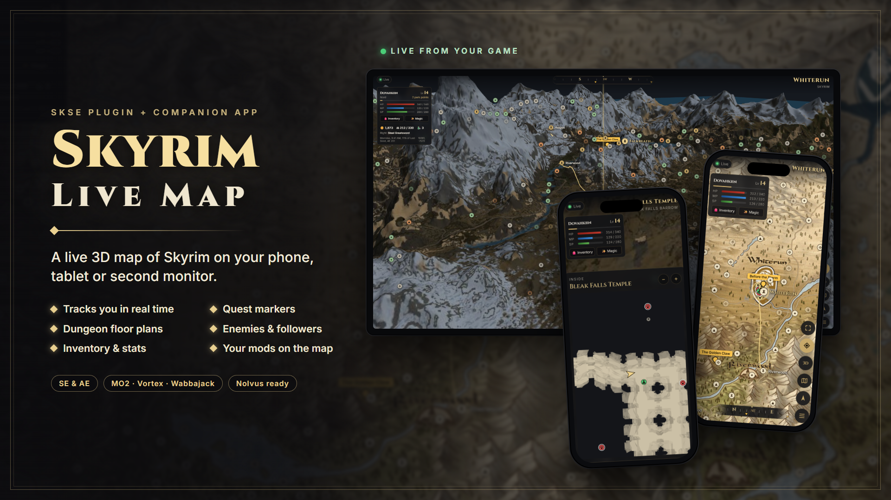
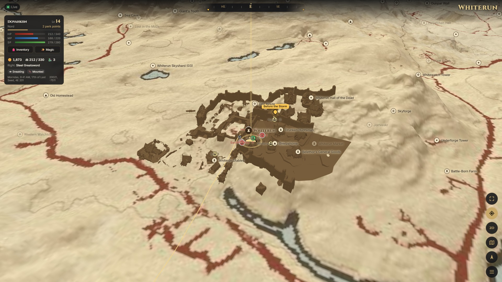
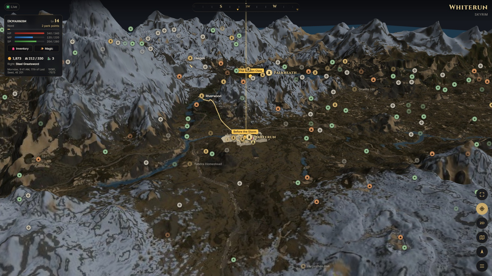
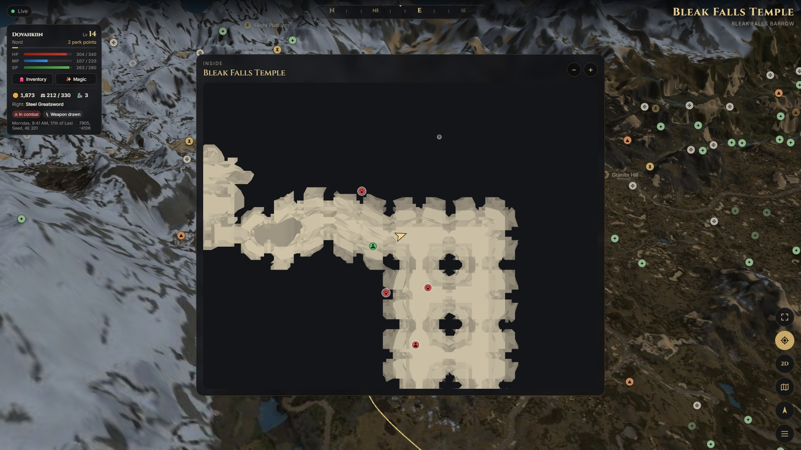
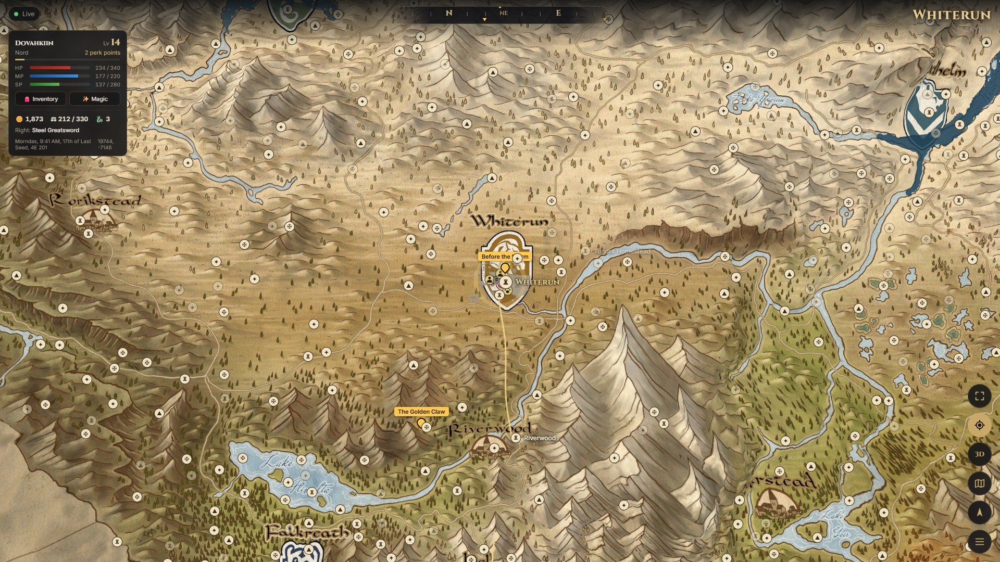
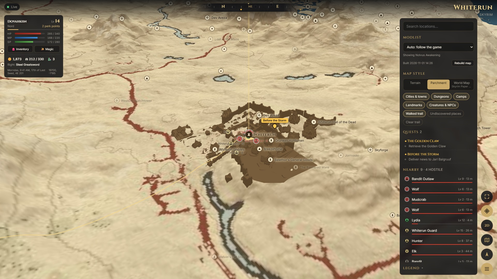
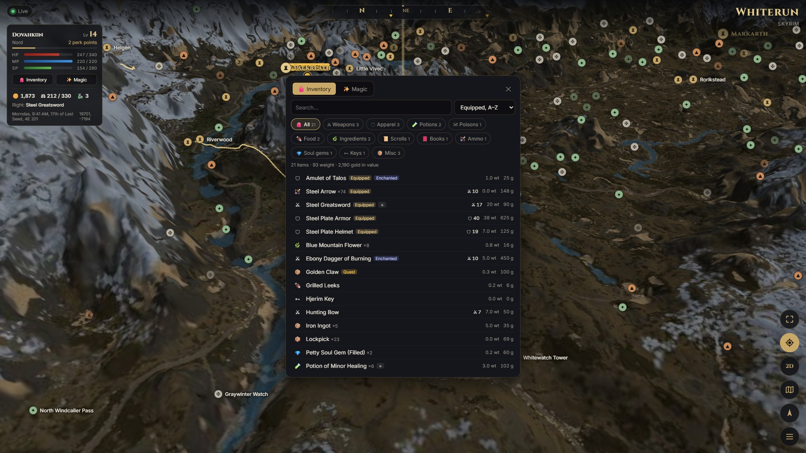
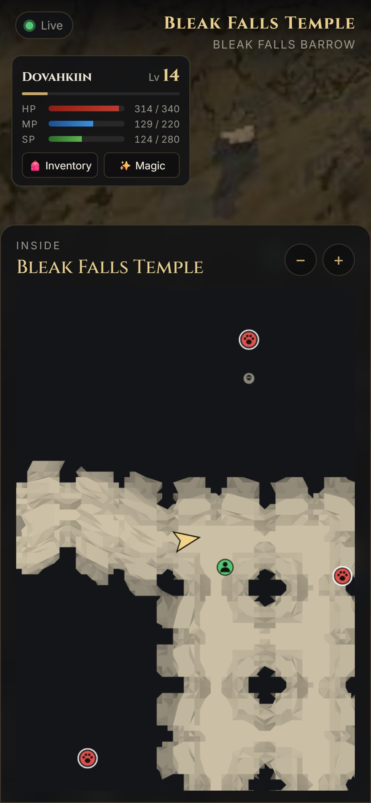
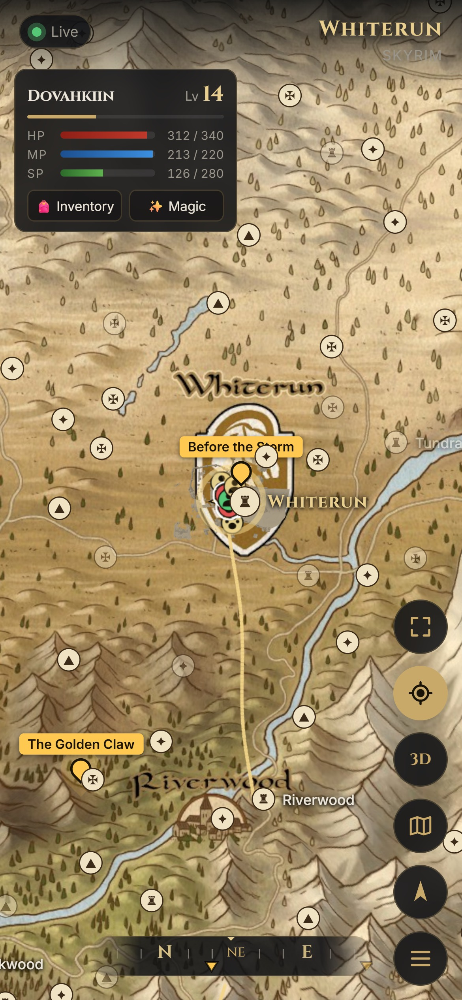
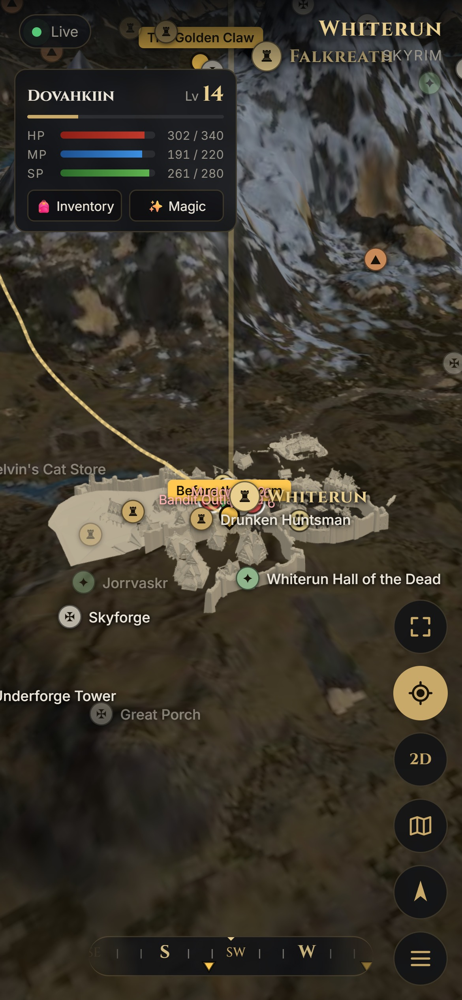

# Skyrim Live Map



A 3D map of Skyrim in your browser that tracks your character live, on a second monitor, phone or tablet: a companion app in the spirit of the RDR2 one.

**Download:** [latest release](https://github.com/AaronCuddeback/skyrim-live-map/releases/latest). You need both the plugin and the app; see [Install (players)](#install-players).

## Screenshots

| | |
|---|---|
|  |  |
| **Parchment style**: real buildings and walls, your trail, quest markers | **Terrain style**: the hold in 3D with your route and quests |
|  |  |
| **Dungeon floor plans**, built for every interior, mod-added ones too | **World Map style**, from your installed world map mod |
|  |  |
| **Quests and nearby** characters with level and health | **Inventory and magic**, searchable and sortable |

<p align="center">
  
  
  
</p>

<sub>Taken with the built-in simulator (`server/simulate.js`) on a Nolvus Awakening map: the map is built from the real load order; the character, enemies and quests are simulated.</sub>

## How it works

```
Skyrim + SKSE plugin ──named pipe, JSON (10 Hz)──▶ relay server (Node) ──WebSocket──▶ any browser on your LAN
                                              └─ also serves the 3D map web app
Skyrim.esm (your copy) ──tools/extract_map.py──▶ web/data/ (terrain, colors, map markers)
```

| Folder | What it is |
|---|---|
| `plugin/` | SKSE plugin (C++, CommonLibSSE-NG). Reads player and nearby actors on the game thread and sends JSON from a background thread over a named pipe (or UDP to a relay on another PC). |
| `server/` | Relay: named pipe and UDP in, WebSocket out, plus static hosting. Also `simulate.js`, a fake game for testing. |
| `web/` | The map: Three.js terrain, markers, live player arrow, mobs, interior radar. |
| `tools/` | `extract_map.py` builds `web/data/` from your own game files and load order (`gamefs.py`: Vortex/MO2 file resolution, `esm.py`: plugin parsing, `mapstyles.py`: map styles). |

## Features

- 3D terrain of all of Tamriel worldspace built from the game's own heightmaps, with baked relief shading.
- **Three map styles**, switchable live (map button or the panel):
  - **Terrain**: colored with the game's actual landscape textures.
  - **Parchment**: a generated old-paper map with sepia relief, contour lines, inked coasts, roads and forests.
  - **World Map**: the in-game world map texture. World map mods (Paper World Map, Quality World Map, …) replace exactly these files, so this matches whatever map mod you have installed. The style button shows which mod it came from.
- **Your load order is included**: DLC, Creation Club and mods. New towns and locations from mods show up with "Added by <plugin>", mod terrain edits reshape the map, and markers a mod removes disappear.
- **Multiple modlists**: Mod Organizer 2 / Wabbajack lists (Nolvus, Kirbykings…) each get their own map, built from their own Stock Game and load order. With the modlist picker on **Auto**, the map switches to whichever list you launch.
- Flat World Map Framework paper maps (Caro's map etc.) are read straight from your list and draped over the 3D terrain.
- Hundreds to thousands of map markers (vanilla has 400+, Nolvus ~1,300) with search and category filters.
- Live player arrow with heading and smooth interpolation. It opens in a close-up 2D top-down view following your character. Zoom out or switch to 3D anytime.
- **Quest markers** for the quests you have selected in your journal: gold pins at each objective's target, plus a Quests list with current objectives. Targets inside dungeons or houses are pinned at the location's entrance, like the in-game map. Tap a pin for the objective, and tap a quest in the list to fly to it.
- Nearby actors as badges: colour shows disposition (red hostile, yellow neutral, green ally, gray dead), the symbol shows what it is (person, creature, dragon, skull), and a white ring means fighting now. They're listed with level and health in "Nearby", and explained in the panel's **Legend**.
- **Character card**: name, race, level with XP progress, perk points, health/magicka/stamina, gold, carry weight, dragon souls, equipped gear, status (combat, sneaking, weapon drawn, mounted) and the in-game date and time. Tap its header to collapse it.
- **Inventory & Magic sheet** (buttons on the character card): every item with category, count, weight, value, damage/armor, and equipped/favorite/enchanted/quest tags; spells by school, powers and shouts with magicka cost, main effect and which hand they're in. Search, category filters and sorting, including value per weight.
- **Discovered places only**: locations you haven't found are hidden, and ones you've only heard of are faded. Turn on **Undiscovered places** in the filters to see everything. Search still finds any location.
- **Walked trail**: a gold line of where you've been, remembered per map and per character, broken at fast travel and doors. Toggle it or clear it in the filters.
- **Destinations**: tap a location or quest pin and choose **Set destination**, or long-press / right-click any spot. A dashed line leads there, and a banner shows distance, ETA from your actual recent speed, and an arrow relative to where you face. It clears itself when you arrive.
- **Interior maps**: inside dungeons, caves, houses and inns, a large panel shows the place's real floor plan, built from the models your load order puts there (mod dungeons and replacers included). It's a cutaway sliced just above your head: the floor you're on is bright, walls show as edges, and lower levels fade. You, nearby actors and doors are drawn on it, and it zooms with +/−, the scroll wheel or pinch. The first visit to a place takes a few seconds to build its map; after that it's instant. Where no map can be built, the old radar shows instead.
- **Buildings outdoors**: the buildings, walls and bridges in the cells around you are added to the map in 3D, in towns, walled cities and anywhere else, as you move.
- Phone-friendly: bottom sheet UI, pinch-zoom and twist-rotate, decluttered markers, lighter mesh on touch devices.
- **Compass**: a Skyrim-style strip at the top (at the bottom on phones) that turns with the way you face, with quest targets (gold) and your destination (blue) at their bearing. Ones behind you sit dimmed at the edge.
- **In-game hotkeys**: move the map without touching the browser. Hold **Num +/−** to zoom (the floor plan when you're inside) and **Num 8/2/4/6** to pan; press **Num 5** to recenter on yourself, **Num 0** for 2D/3D and **Num .** for the next map style. They're ignored in menus and the console, and every open copy of the map follows them.
- **In-game settings page** in SKSE Menu Framework (F10 by default; Nolvus and Kirbykings include it): connection status, buttons for the same map controls, hotkey rebinding (Change, then press a key; Esc cancels), and the update rates. Without the framework, set the same things in `SkyrimLiveMap.ini`.
- **Full screen**: the ⛶ button hides the browser UI on Android and desktop. On iPhone/iPad, use Share → **Add to Home Screen** and open the map from that icon. It then runs without browser bars (the button explains this on iOS).
- Works with walled cities (Whiterun, Solitude…), which share Tamriel's coordinates.

## Install (players)

The Nexus release is two downloads; nothing else to install:

1. **Plugin** (`SkyrimLiveMap-Plugin-<ver>.zip`): install it with MO2 or Vortex like any SKSE mod. Needs SKSE64 and Address Library.
2. **App** (`SkyrimLiveMap-App-<ver>.zip`): extract the folder anywhere and run `SkyrimLiveMap.exe`. It carries its own Node.js and Python, prints the map's address and a QR code, and stops when you close its window.

The first time a modlist connects, the app builds that list's map from its own files (a minute or two, with progress on the map page). Maps live in `%LOCALAPPDATA%\SkyrimLiveMap\maps`; **Rebuild map** in the panel redoes one after a modlist update. `packaging/README.txt` is the player-facing guide that ships in the app folder.

## Setup (from source)

### 1. Game prerequisites

**SKSE64** and **Address Library for SKSE Plugins**. Wabbajack lists (Nolvus, Kirbykings, …) already include both. For a plain install: <https://skse.silverlock.org> and <https://www.nexusmods.com/skyrimspecialedition/mods/32444>. The plugin works on SE 1.5.97 (Nolvus) and AE 1.6.x alike.

### 2. Generate the map data (once per modlist, and again when a list updates)

The relay does this by itself: when a game it has no map for connects, it runs `extract_map.py --game <the game folder>`, which works out the setup from the folder the plugin reports. Plugin 1.0 also reports where the Mod Organizer that launched the game lives. Without that, it looks for an MO2 instance next to the game folder (Wabbajack layout) or among MO2's global instances; otherwise it's a plain/Vortex install. Viewers see the progress, and the panel's **Rebuild map** reruns it for the map on screen. To run it by hand:

One-time Python setup:

```powershell
cd tools
python -m venv .venv
.venv\Scripts\pip install numpy pillow lz4
```

Then build a map for each modlist you play. Point `--mo2` at the list's folder (the one containing MO2 or `ModOrganizer.ini`):

```powershell
cd server
npm run extract -- --mo2 "D:\NolvusV6\Instances\Nolvus Awakening" "D:\Modlists\SKNEM"
```

It takes about 30 seconds per big list. Each list lands in `web/data/<name>/` (or `$env:SLM_DATA`), and `datasets.json` there lists them all. Open browsers pick up new data on reload.

- **Wabbajack / MO2**: the game files come from the list's own Stock Game / Game Root (read from `ModOrganizer.ini`), and mods, priorities and plugins from its selected profile. Use `--profile "Kirbykings NSFW Edition"` for another profile and `--name` to rename the map.
- **Plain Steam install / Vortex**: run with no arguments (or add `--vanilla` alongside `--mo2`). Vortex deploys into `Data`, and active plugins come from `%LOCALAPPDATA%\Skyrim Special Edition\plugins.txt`.
- Non-English games: `--lang french` (etc.) for localized names.

The output lists each plugin that changed the map (markers added/removed, terrain edits) and where the world map texture came from. `loadorder.txt` in each map folder records the load order it was built from.

Mod-added *worldspaces* (separate maps such as Solstheim, Bruma or Wyrmstooth) aren't drawn; only Tamriel and the city worldspaces inside it are.

### 3. Build the SKSE plugin

Needs Visual Studio 2022 with the C++ workload (it ships CMake and vcpkg). The first build downloads and compiles CommonLibSSE-NG from the colorglass vcpkg registry, which takes 10–20 minutes.

```powershell
$vs = "C:\Program Files\Microsoft Visual Studio\2022\Community"
$env:VCPKG_ROOT = "$vs\VC\vcpkg"
$env:PATH = "$vs\Common7\IDE\CommonExtensions\Microsoft\CMake\CMake\bin;$env:PATH"
cd plugin
cmake --preset release
cmake --build --preset release
```

Output: `%LOCALAPPDATA%\slm-build\build\Release\SkyrimLiveMap.dll`. The build tree lives there, not under `plugin\`, because vcpkg's nested folders otherwise blow past Windows' 260-character path limit. Set `SKYRIM_DATA` to your `Data` folder before configuring if you want the DLL copied there automatically.

### 4. Install the plugin

A ready-built mod archive is in `dist\SkyrimLiveMap-Plugin-1.0.0.zip` (contains `SKSE/Plugins/SkyrimLiveMap.dll`, `.ini` and the third-party notices).

- **MO2 / Wabbajack lists**: in each list's MO2, *Install a new mod from an archive*, pick the zip, and enable it. Put it near the bottom of the left pane (it conflicts with nothing). Adding a mod doesn't break a Wabbajack list, but its next update may ask what to do with unknown mods. Keep it, or re-add it afterwards.
- **Vortex**: drag the zip onto the Mods page and enable it.

The plugin also reports which game folder it's running from, which is how the map's **Auto** mode knows whether you launched Nolvus or SKNEM.

The INI sets how the game reaches the relay, update rates and the actor limit. By default (`Transport=pipe`) the game hosts the Windows named pipe `\\.\pipe\SkyrimLiveMap` and a relay on the same PC connects to it. Either side may run as administrator, and either may start first or restart; they reconnect within a second. (In 0.7.1–0.7.2 the relay hosted the pipe, and a relay started as administrator got no data.) A pipe isn't network traffic, so ReShade's standard build keeps its add-ons enabled. Versions before 0.7.1 sent UDP, which made ReShade show *"High network activity discovered. All add-ons are disabled"*. Set `Transport=udp` and `Host=<relay PC's LAN IP>` only if you run the relay on a different computer; ReShade's standard build will then disable add-ons again, and its "full add-on support" build won't. Log: `Documents\My Games\Skyrim Special Edition\SKSE\SkyrimLiveMap.log`.

### 5. Run it

```powershell
cd server
npm install
npm start
```

It prints the URL for other devices and a QR code for your phone. The first time, **allow Node through Windows Firewall on Private networks**, or other devices can't connect. Launch the game the way the list says (through MO2 / the Nolvus dashboard, using SKSE) and the map goes **Live**. With the panel's **Modlist** picker on Auto, it opens the map for the list you launched. If the status says "no map built for this game", run the extract step for that list.

### Testing without the game

```powershell
cd server
npm start          # terminal 1
npm run simulate   # terminal 2: rides Helgen → Riverwood → Bleak Falls → Whiterun with wolves, a follower, NPCs
```

The simulator pretends to play the first map in `datasets.json`. Use `$env:MAP="sknem-kirbykings-nsfw"; npm run simulate` to pretend to be another list and watch Auto mode switch.

### Diagnosing a live session

With the server and game running (game window focused, since Skyrim pauses when it isn't), these connect as an extra read-only viewer:

```powershell
cd server
node capture.mjs 6                    # 6-second summary: packet counts, player, sample actors, quests
node record.mjs 120 session.jsonl     # save 2 minutes of everything the game sends
$env:UDP_PORT="27016"; node replay.mjs session.jsonl   # play it back into a test server (HTTP_PORT=8788, UDP_PORT=27016)
```

## Packet format (plugin → relay)

```json
{ "t": "state", "x": 21941.0, "y": -44792.0, "z": -140.0, "h": 1.5708,
  "interior": false, "ws": 60, "wsParent": 0, "lvl": 14, "hp": 0.85, "combat": false, "mounted": false,
  "cell": "", "location": "Riverwood", "game": "D:\\NolvusV6\\Instances\\Nolvus Awakening\\STOCK GAME",
  "actors": [ { "id": 4278190336, "x": 0, "y": 0, "z": 0, "h": 0, "lvl": 6, "hp": 1.0,
                "combat": true, "npc": false, "state": "hostile", "name": "Wolf", "race": "Wolf" } ] }
```

Since plugin 0.3.0, actors travel in their own numbered batches of up to 24 (`{"t":"actors","seq":7,"part":0,"parts":3,"actors":[…]}`), so a busy exterior never produces one huge packet, and a bad value can't sink the whole list. The map applies a list once every part of a batch has arrived, and still accepts the older format with `actors` inside the state packet. The relay logs any packet it rejects.

Since 0.4.0, a quest packet goes out once a second with the quests selected in the journal, their displayed objectives, and the game's current compass targets:

```json
{ "t": "quests", "quests": [ { "id": 110719, "name": "The Golden Claw",
    "objectives": ["Retrieve the Golden Claw"],
    "targets": [ { "x": 1482, "y": -41162, "z": 5727, "text": "Retrieve the Golden Claw", "inside": "Bleak Falls Barrow" } ] } ] }
```

`inside` is set when the target is indoors; the position is then the location's world map marker.

Since 0.5.0, a player packet also goes out once a second (`hp`/`mp`/`sp`/`carry` are `[current, max]`, `xp` is progress to the next level, 0–1):

```json
{ "t": "player", "name": "Dovahkiin", "race": "Nord", "lvl": 14, "xp": 0.42, "perks": 2,
  "hp": [340, 340], "mp": [135, 220], "sp": [205, 280], "gold": 1873, "carry": [212, 330], "souls": 3,
  "sneak": false, "drawn": true, "combat": true, "mounted": false,
  "right": "Steel Greatsword", "left": "Steel Greatsword", "time": "Morndas, 9:41 AM, 17th of Last Seed, 4E 201" }
```

Since 0.6.0, three batched packets go out every 5 seconds (same `seq`/`part`/`parts` framing as actors):

- `discovered`: `"discovered": ["skyrim.esm:01BDD8", …], "known": [...]`. These are map marker ids in the same `plugin:LOCALID` form as `markers.json`; *known* means seen on the map but never visited.
- `inventory`: `"items": [{ "n": "Steel Greatsword", "k": "weapon", "c": 1, "w": 20, "v": 90, "d": 17, "a": 0, "e": 1, "f": 1, "x": 0, "q": 0 }]` (count, weight, value, damage, armor, equipped, favorite, enchanted, quest item).
- `magic`: `"spells": [{ "n": "Flames", "k": "destruction", "c": 14, "eq": "left", "fx": "Fire Damage · 8 pts" }]`. `k` is a school, `power` or `shout`; `eq` is `left`/`right`/`both`/`power`.

The plugin builds quest, player, discovery, inventory and magic packets under a crash guard: if reading one ever faults, that packet is switched off until the game restarts (see `SkyrimLiveMap.log`) instead of crashing the game.

The menu saves its changes to `SkyrimLiveMap.ini`. Under MO2 that copy lands in the list's **overwrite** folder and takes priority over the one in the mod, including after you install a newer zip. Delete it there to go back to the defaults.

Every 30 seconds the log also records how much game-thread time the map took (`Game-thread cost: … ms per second`), split by packet type, and whether the relay is connected (`Relay: relay connected`). Use it to rule the map in or out when the game runs slowly.

Since 0.7.0 the state packet also carries `cellKey` (the interior cell, e.g. `skyrim.esm:0371DE`) and `wsKey` (the worldspace, e.g. `skyrim.esm:00003C`).

Since 0.8.0, hotkeys send `{"t":"input","a":"zoomIn","s":1}` when a key goes down (repeated with `"repeat":true` every 250 ms while it's held) and `"s":0` when it's released; the map treats a key as released after 0.8 s without a repeat. The menu's buttons send a single step with `"tap":true`. Actions: `zoomIn`, `zoomOut`, `panUp`, `panDown`, `panLeft`, `panRight`, `follow`, `view`, `style`.

## Local maps (interiors and buildings)

`extract_map.py` also writes, per map:
- `localindex.json`: where each interior cell's and outdoor cell's placed objects sit in which plugin.
- `models.json`: each building piece's model.

When the map asks for a cell (`/api/local?map=…&cell=…`, or `&world=…&x=…&y=…` outdoors), the server hands the request to `tools/localmap.py`. It runs as one long-lived worker, which:
1. reads that cell's objects across your load order,
2. loads their models (NIF, SE and LE formats, through your mods),
3. places, simplifies and filters them (clutter, decoration, effects and markers are skipped; rocks are trimmed first if a cell is very large),
4. caches the result in `web/data/<map>/local/`.

The cache is cleared whenever you re-extract that map. To build one by hand:

```powershell
cd tools
.venv\Scripts\python localmap.py --map nolvus-awakening --cell "skyrim.esm:0371DE"
```

Positions are Skyrim units (X east, Y north, Z up). `h` is the heading in radians, clockwise from north. Actors are sent at `ActorHz` (default 2 Hz). `ws` 60 (0x3C) is Tamriel. `game` is the folder of the running `SkyrimSE.exe`, matched against each map's `gamePath` in `datasets.json`. `mo2` (plugin 1.0+) is the folder of the Mod Organizer 2 that launched the game, or empty when it wasn't MO2; the relay uses both to build a missing map.

## Building a release

```powershell
tools\.venv\Scripts\python.exe tools\package.py
```

Build the plugin first. The script reads the version from `plugin/CMakeLists.txt` and writes `dist\SkyrimLiveMap-Plugin-<ver>.zip` and `dist\SkyrimLiveMap-App-<ver>.zip`. The app zip holds:

- `SkyrimLiveMap.exe`, a small launcher built from `launcher/` with MSVC;
- `app\` (server, web app without map data, Python tools);
- `runtime
ode` (this PC's `node.exe`);
- `runtime\python`, a trimmed private Python assembled from the venv's base install plus numpy, Pillow and lz4.

The script checks that the bundled Python can import every tool before it zips. When packaged (a `runtime\python` beside `app\`), the relay keeps maps in `%LOCALAPPDATA%\SkyrimLiveMap\maps`. `packaging/` has the player README, the third-party notices and the Nexus page text.

## Ideas for next steps

- Show only locations you've discovered (read map marker flags from the save).
- Quest target markers and custom waypoints synced back into the game.
- Solstheim (Dragonborn) map.
- Tap-to-fast-travel from the phone (the plugin would need to accept commands).

## Legal

`web/data/` (and `%LOCALAPPDATA%\SkyrimLiveMap\maps`) is generated from your own copy of the game and contains derivatives of Bethesda's assets. Keep it for personal use; don't publish it. That's why the release ships no map data and builds it on each player's PC.

## License

MIT, see `LICENSE`. Bundled third-party code keeps its own license: `plugin/src/vendor/SKSEMenuFramework.LICENSE.txt`, and `packaging/*-NOTICES.txt` for everything the release archives include.
